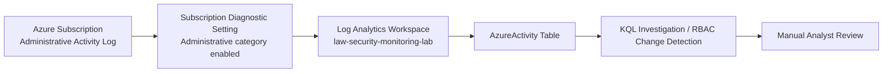

# Azure Security Monitoring Lab

A hands-on Microsoft Azure security monitoring project demonstrating subscription Activity Log export to Log Analytics, Kusto Query Language (KQL) investigation, and detection of Azure RBAC permission changes.

> **Scope:** Controlled learning environment using Azure for Students. This is a validated **manual detection and investigation lab**, not a production SIEM deployment or automated alerting solution.

## Objectives

- Collect subscription-level Azure administrative events into a Log Analytics workspace.
- Investigate activity with KQL.
- Detect successful Azure RBAC role assignment creation and removal.
- Verify detection using a controlled least-privilege test.
- Remove temporary access after testing and document limitations.

## Architecture

See [architecture notes](diagrams/architecture.md).

## Lab resources

| Component | Lab configuration |
| --- | --- |
| Azure region | East Asia |
| Resource group | `rg-security-monitoring-lab` |
| Log Analytics workspace | `law-security-monitoring-lab` |
| Subscription diagnostic setting | `diag-security-monitoring-lab` |
| Exported category | Administrative |
| Destination table | `AzureActivity` |
| Workspace daily cap | 0.1 GB/day (not a guaranteed cost ceiling) |
| Test principal | Existing user-assigned managed identity |
| Test role | Reader, temporarily scoped to monitoring resource group |

No Microsoft Sentinel, virtual machine, alert rule, or notification channel was configured for this lab.

## Validated test (12 November 2026)

1. Created the monitoring resource group and Log Analytics workspace.
2. Enabled subscription-level Administrative Activity Log export to the workspace.
3. Generated a resource group tag update after enabling the diagnostic setting.
4. Verified that its Start and Success records appeared in `AzureActivity` after an ingestion delay.
5. Assigned a temporary **Reader** role to an existing managed identity at `rg-security-monitoring-lab` scope.
6. Confirmed the role assignment **write** operation succeeded in the subscription Activity Log.
7. Deleted the **specific temporary assignment** and confirmed the **delete** operation succeeded in the subscription Activity Log.
8. Ran a KQL detection query and observed **two successful change records**:
   - `Role Assigned` — **2026-11-12 14:01:09 UTC**
   - `Role Removed` — **2026-11-12 14:03:54 UTC**

Both successful RBAC events were returned by a manual query in Log Analytics. This verifies detection for the specific controlled scenario, **not** continuous alerting or general detection coverage.

## Queries

- [Detect successful RBAC changes](queries/detect-rbac-changes.kql)
- [Inspect recent Azure administrative events](queries/recent-administrative-events.kql)

Run the queries in **Azure Portal → Log Analytics workspaces → law-security-monitoring-lab → Logs**. Adjust time windows for future use.

## Findings and limitations

See [security assessment](security-assessment.md) for the evidence-based interpretation, detection limitations, and potential follow-up work.

Key limitations:
- Detection was **manually executed**, not scheduled or connected to alerts.
- A role change is not inherently malicious; an analyst must validate identity, role, scope, and authorization.
- Only a narrow set of controlled administrative events was tested.
- Logs experienced ingestion delays; absence of a recent event is not proof it did not happen.
- A workspace daily ingestion cap may stop collection and should not be treated as a complete billing safeguard.

## Evidence and privacy

A suggested evidence checklist is provided in [evidence/README.md]. Screenshots should be reviewed before publication. Redact tenant/subscription identifiers, correlation IDs where unnecessary, personal login addresses, and other identifying information.

## What I learned

The exercise demonstrates the difference between **source events** in Azure Activity Log and **delivered records** in Log Analytics. Successful resource operations and correct diagnostic configuration do not, by themselves, prove KQL detection. I validated the full path by generating, observing, and investigating post-configuration RBAC changes.

## Security note

This lab does not recommend assigning excessive permissions to generate monitoring data. The temporary role was Reader, scoped to a single lab resource group, and removed after testing.
