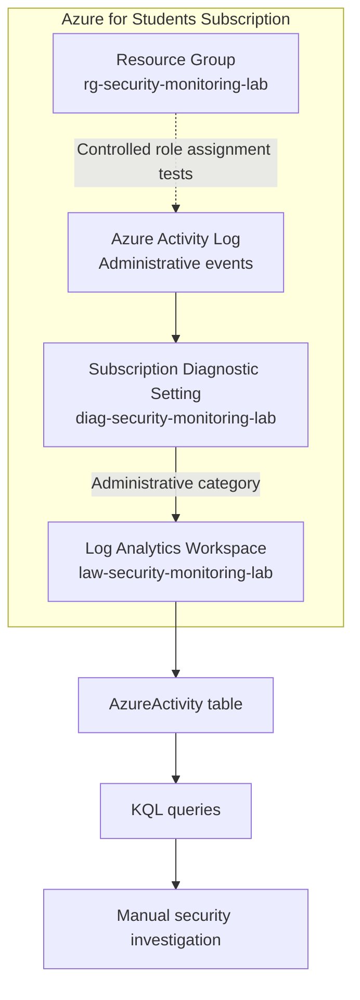

# Monitoring Architecture

## Data flow

1. Azure Resource Manager operations create subscription Activity Log entries.
2. The subscription diagnostic setting exports the **Administrative** category to the Log Analytics workspace.
3. Records arrive in the **AzureActivity** table after delivery and ingestion delays.
4. A user runs KQL queries manually to find role assignment writes and deletes.

## Boundary of the lab

- No virtual machine, agent, resource-level diagnostics, Microsoft Sentinel, or automated alerting.
- Only subscription-level Administrative Activity Logs were forwarded.
- This diagram represents the **verified logical configuration**, not a measured network path or a high-availability deployment.
